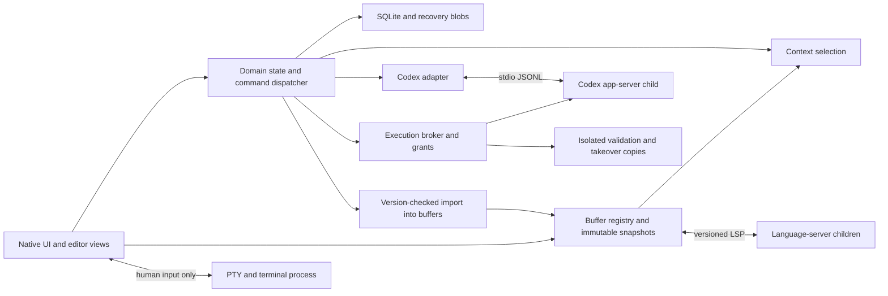

# Architecture and technical research

> **Historical.** This document describes the earlier Codex-based design, which was replaced on 2026-11-15 by the Claude chat companion. The current design is in [companion.md](companion.md).

Status: implemented guided-companion boundaries below, with historical architecture research dated 2026-11-13 retained in the numbered sections. [Plan entry point](README.md).

Evidence labels in the historical research: **observed** means a local read-only inspection; **documented** means upstream documentation or source; **proposed** means the design at that time; **gate** means a then-future check. No runtime integration, performance or sandbox behavior was tested during that research phase. Current D/S/R/partial M results are in [guided-companion.md](guided-companion.md) and [verification.md](verification.md).

## Implemented guided-companion boundaries

`TaskSession` is the durable authority, created before any model request. It owns the conversation, separately versioned Spec and Plan, exact human approvals, execution generation, explicit Start, pending clarification and walkthroughs. The legacy task table is a compatibility projection for outline/progress; chat, model proposals and historical manual completion cannot create approval or execution authority. Legacy adoption creates a linked session with missing documents/approvals to resolve explicitly.

A `DocumentRef` binds revision/hash. The Plan definition includes its exact Spec reference. Saving changed Spec invalidates both approvals; saving changed Plan invalidates its own; no-op saves preserve approvals. Storage revalidates current optimistic sequence and workflow binding on transitions. Asynchronous requests retain session/task/document/generation bindings and cannot publish after those change.

One walkthrough action is active at a time. Review binds immutable source/overlay snapshots, relevant journal state, exact check receipts and current attachments. A current passing assessment enables an atomic, exactly-once explicit Next; it does not advance itself. Final completion covers the full Spec. Historical actions/reviews remain readable without being relabelled current. User-attached command output retains unauthenticated provenance; it is not equivalent to an isolated check receipt.

The host research broker bounds local reads and fixed inspection recipes without granting model filesystem/shell authority. A separate public worker sees only a screened generic brief and public results, with a snapshotted selected model. Bounded anonymous HTTPS retrieval excludes private addresses, credentials and unsupported content; local code/documents/transcript never enter that worker. Returned sources remain untrusted. Research cannot approve, edit, authorize checks or Takeover. The HTTP/TLS/HTML parsing dependency closure enters the existing locked notice inventory.

The global model preference is Automatic or an explicit live catalog identity. Automatic uses the unique account default and supported default effort per operation. Missing explicit choices remain selected and block work. One operation guard owns loading/phase/cancel cleanup and stale-result rejection; the picker is disabled through all active AI work. Default solutions remain hidden, including ordinary and accessibility presentation. An explicit Reveal or standing AutomaticPreview preference targets only the current approved/started action/language and grants no edits.

Ordinary editing, terminal use and separately authorized offline checks are independent of this lifecycle. Takeover requires the current workflow binding plus its existing exact path/check grant at preparation, dispatch and import; imported buffers still need action review. Document revisions revoke old execution authority while retaining staged work.

Schema 5 persists sessions/documents/transitions and retains pre-migration backups. Store refuses future schemas without rewriting their data. SQLite closes before the final Store lock explicitly unlocks, so a child inheriting the descriptor cannot strand a released profile lock; exclusive nonblocking acquisition still excludes live owners. The exact earlier intermittent child's identity is unknown; the controlled regression and current test results are recorded separately from historical failures. Install/rollback switches immutable bundles without downgrading profile data.

## 1. Ranked application choices

Criteria, in order: reliable daily editing and source protection; fit with a Rust-native personal application; effort to reach the companion workflow; accessibility/input correctness; maintenance and future platform cost. These are qualitative judgments, not benchmark results.

| Rank | Architecture | Strengths | Costs and reason for ranking |
| --- | --- | --- | --- |
| **1 — recommended** | Rust + GPUI Kit 0.9.1, using its pinned upstream GPUI snapshot | Native Rust throughout; existing editor, tree, tabs, diff, focus and accessibility infrastructure; custom product UI without adopting an IDE | Pre-1.0 APIs and recent ecosystem changes; real LSP client, project model, terminal view and durable buffer management remain ours. M0-B must prove input/accessibility and integration before commitment |
| **2 — fallback requiring approval** | Rust + Tauri 2 + Monaco, small TypeScript UI | Mature browser editor primitive, existing edit models and providers; web accessibility tools; fewer editor mechanics to own | A substantial frontend is TypeScript, contrary to the preference for Rust; WKWebView input/workers/CSP/IPC still need testing. Monaco is not all of VS Code and does not run its extensions. More language/runtime boundaries |
| **3 — not selected** | Rust + Floem and floem-editor-core | Native Rust; editor lineage from Lapce; permissive licenses; multiple renderers | Credible editor foundation, but a less current tagged release baseline than GPUI Kit in inspected release metadata. More integration/release-management uncertainty; not worth maintaining a second native prototype unless the preferred option fails |

GPUI itself explicitly describes breaking changes before 1.0. GPUI Kit's v0.9.1 manifest pins `gpui-pre` and related snapshot crates to 0.3.12 because compatible-looking snapshot updates previously broke consumers. Use that default backend, not the optional GPUI Fast fork. Do not follow arbitrary upstream `main` revisions. [GPUI README](https://github.com/zed-industries/zed/blob/main/crates/gpui/README.md), [Kit release](https://github.com/longbridge/gpui-kit/releases/tag/v0.9.1), [pinned manifest](https://github.com/longbridge/gpui-kit/blob/v0.9.1/Cargo.toml).

Kit provides `Editor`/`EditorState`, search/replace and provider hooks. Its example's `ExampleLspStore` reads fixtures and simulates completions: it is evidence of an integration surface, **not a ready language-server manager**. Its performance/accessibility claims need our own checks. [Editor documentation](https://gpui-kit.com/component/editor/), [versioned example](https://github.com/longbridge/gpui-kit/blob/v0.9.1/examples/editor/src/main.rs).

The fallback would use a purpose-built TypeScript interface and Monaco, with Rust owning permissions, processes and durable state. Tauri uses a native WebView rather than bundling an entire IDE. Do not adopt a Tauri 3 alpha merely because release discovery labels it latest. [Tauri architecture](https://v2.tauri.app/concept/architecture/), [Monaco integration concepts and limitations](https://github.com/microsoft/monaco-editor), [Floem editor release](https://github.com/lapce/floem/releases/tag/v0.2.0).

## 2. Reuse, learn from, and own

| Project/component | Decision and integration cost | License and maintenance evidence |
| --- | --- | --- |
| GPUI Kit editor/UI | Reuse editor, tree/tabs, diff and common controls; medium/high integration cost. Wrap only the editor-facing operations needed by Tandem | Apache-2.0 software. v0.9.1 published 2026-11-09; exact GPUI snapshot pins. Preserve copyright, license and applicable notices; mark modifications. Documentation has separately stated CC BY terms—write original documentation. [License](https://github.com/longbridge/gpui-kit/blob/v0.9.1/LICENSE-APACHE), [README](https://github.com/longbridge/gpui-kit) |
| Zed | Learn from responsiveness, task scheduling, navigation, LSP lifecycle and terminal layout. Reuse only explicitly permissive GPUI dependencies via Kit; do not extract its editor wholesale | Zed's current README says primarily GPL-3.0-or-later, Apache-2.0 where marked. Zed v1.28.1 release observed 2026-11-11. A crate-level audit is necessary before copying any source. [Licensing](https://github.com/zed-industries/zed#licensing) |
| Lapce/Floem | Learn from editor-core separation, project proxies and LSP routing; alternative foundation, not a second dependency stack | Floem MIT; v0.2.0 latest tagged release found, 2024-11-15, while main continues changing. Lapce v0.4.6 released 2026-01-21. Old tag does not prove abandonment. [Floem](https://github.com/lapce/floem), [Lapce releases](https://github.com/lapce/lapce/releases) |
| Tree-sitter | Use Kit's selected Rust/Python grammars and incremental highlighting; do not create a second parser/cache without need. Low/medium cost | Core MIT; grammar/query licenses are separate and must enter the locked dependency inventory. [Core license](https://github.com/tree-sitter/tree-sitter/blob/master/LICENSE) |
| `alacritty_terminal` | Reuse terminal state machine/grid; implement a small GPUI view and input bridge. High cost relative to a command-output pane; prove a thin slice early | 0.26.0 in Alacritty v0.17.0; Apache-2.0. Reuses parser, not the entire Alacritty UI. [Manifest](https://github.com/alacritty/alacritty/blob/v0.17.0/alacritty_terminal/Cargo.toml) |
| `portable-pty` / WezTerm | Reuse PTY creation, IO and resizing; learn process lifetime handling. Use its PTY with the terminal grid, not both libraries' competing IO loops | MIT; inspected manifest 0.9.0. WezTerm's old stable application release is not proof of current PTY-crate stability; pin a tested crate. [Manifest](https://github.com/wezterm/wezterm/blob/main/pty/Cargo.toml) |
| `lsp-types`, rust-analyzer, Pyright | Reuse protocol types and external servers. Build a bounded client/manager, not a language server. Medium/high cost | lsp-types MIT, inspected 0.97.0; rust-analyzer MIT/Apache-2.0; Pyright MIT. Active sources, but runtime compatibility must be recorded per fixture. [Types](https://github.com/gluon-lang/lsp-types), [rust-analyzer](https://rust-analyzer.github.io/book/other_editors.html), [Pyright](https://github.com/microsoft/pyright) |
| ripgrep `ignore`/search crates | Reuse ignore-aware traversal and search; avoid a new indexing service. Medium cost for cancellation, limits and result navigation | MIT/Unlicense choices; keep chosen terms and notices. [Project](https://github.com/BurntSushi/ripgrep) |
| `notify`, `rusqlite` + SQLite | Filesystem events and local transactions; low/medium cost. Watcher events are hints followed by reconciliation | notify CC0-1.0; rusqlite MIT; SQLite public domain. Inspected main manifests: notify 9.0.0-rc.8, rusqlite 0.42.0; **not release recommendations**. Choose compatible stable releases after approval. [notify](https://github.com/notify-rs/notify), [rusqlite](https://github.com/rusqlite/rusqlite), [SQLite](https://www.sqlite.org/copyright.html) |
| Codex runtime | Bundle a compatible executable after M0, supervise it rather than link its internal Rust crates. Medium adapter cost, high security/recovery importance | Apache-2.0 repository; preserve LICENSE/NOTICE and audit shipped binary dependencies. Source license does not itself grant unlimited hosted service use. [License](https://github.com/openai/codex/blob/rust-v0.169.0/LICENSE), [release](https://github.com/openai/codex/releases/tag/rust-v0.169.0) |

MIT reuse retains copyright/license notices; Apache reuse also preserves applicable NOTICE material and change notices. Before packaging, generate a dependency/license inventory from the exact lockfile and bundled binaries, include fonts/icons/grammars, and inspect transitive exceptions. Use system fonts initially; do not assume Kit's icons or themes share its code license. No Tandem license choice or upstream trademark reuse is implied. No components have been downloaded for installation or built.

## 3. Component and process boundaries

Start as a small Rust workspace: one desktop binary and a testable domain library, with modules rather than many micro-crates. Separate transport/platform adapters only where they have concrete ownership. Use the GPUI event loop for UI; background IO workers communicate through bounded channels. Select the smallest compatible async setup during M0 rather than combine runtimes casually.



| Owner | Responsibility and boundary |
| --- | --- |
| Desktop shell | Windows, menus, focus, shortcuts, accessibility, file dialogs and status; never interprets model text as a command |
| Buffer/workspace layer | File identities, edit revisions, save baselines, dirty recovery, tabs, watch reconciliation and undo transactions. GPUI editor is the sole mutable text owner per buffer; domain receives immutable snapshots, not a second competing text model |
| Language manager | Server lifecycle, document sync, UTF-8/UTF-16 positions, capabilities, cancellation, diagnostics and provider adapters; no assumption that a parser supplies LSP |
| Task coordinator | Durable TaskSession, versioned Spec/Plan and human approvals, Start, action reviews and exactly-once Next; ordinary conversation grants no implementation authority |
| Guidance resolver | Per-field inheritance, effective settings and provenance; no permission decisions |
| Review/improvement service | Snapshot capture, structured result validation, applicability checks and evidence links; cannot mark checks passed from model assertions |
| Codex adapter | Wire framing, request IDs, streaming, auth state, thread IDs, typed errors and runtime version; no direct UI mutation |
| Execution broker | Granted roots/actions/recipes, sandbox profiles, command receipts, cancellation and import authorization; rejects model-originated expansion of scope |
| Persistence | Transactions, schema migrations, operation journals, task history and recovery. Credentials are never in this database |

The human terminal is an ordinary developer shell with the user's OS permissions, not an AI tool or a sandbox promise. Agent output cannot type into it. Opening an untrusted folder does not automatically run LSP project code, build scripts or terminal startup commands; these require the project's executable-tool trust decision. Such trust does not grant the AI takeover rights.

## 4. Codex choice and subscription authentication

| Concern | Direct app-server from Rust — recommended | Official TypeScript SDK | Official Python SDK |
| --- | --- | --- | --- |
| Runtime fit | Rust JSON/stdio client plus Codex executable | Node 18+ plus SDK and Codex CLI | Python 3.10+ plus SDK/pinned runtime |
| Intended use | Rich interactive client | Task/workflow automation | App-server convenience layer for Python applications |
| Sign-in | Managed account login/status/logout protocol | Reuses CLI environment/auth; a separate UI lifecycle still needed | Explicit managed ChatGPT browser/device-code helpers |
| Continuity/streaming | Threads, turns and item notifications | Start/resume threads; `runStreamed()` | Start/resume and streaming through app-server |
| Cancellation/approvals | Explicit interruption and server-request handling | `AbortSignal` is present in the inspected turn options; that is not evidence of equivalent interactive approval handling | Exposes app-server operations, but adds a Python process/bridge for a Rust UI |
| Structured results | Per-turn schema plus app validation | Output schema support | Typed wrapper over underlying turns |
| Permissions/tools | Direct access to version-specific fields and approval requests | Config/sandbox options; wrapper surface can lag new protocol | Similar underlying capabilities, bounded by wrapper version |
| Distribution/recovery | Tandem owns binary compatibility and lifecycle | Extra Node packaging and adapter | Extra Python packaging and adapter |

Current official guidance recommends app-server for a custom client with authentication, history, approvals and streaming. The SDK documentation now includes **both TypeScript and Python**; do not base the decision on an obsolete “only TypeScript exists” assumption. The Python SDK is a credible path, but Rust can speak the protocol without that extra runtime. [SDK guide](https://learn.chatgpt.com/docs/codex-sdk), [TypeScript source](https://github.com/openai/codex/blob/rust-v0.169.0/sdk/typescript/README.md), [Python source](https://github.com/openai/codex/blob/rust-v0.169.0/sdk/python/README.md), [platform overview](https://developers.openai.com/blog/codex-as-a-platform).

The SDK comparison uses documentation and source at Codex's release tag, not an installed SDK or a claim that SDK package versions equal CLI versions. The TypeScript source manifest identifies itself as a development package; no SDK was installed or executed. [Turn cancellation options](https://github.com/openai/codex/blob/rust-v0.169.0/sdk/typescript/src/turnOptions.ts).

### Authentication ownership

Proposed: launch the child with a Tandem-specific `CODEX_HOME` under the user's Application Support directory, a scrubbed environment, official OpenAI provider, and `forced_login_method = "chatgpt"`. Codex owns login callbacks, token refresh and Keychain storage (`cli_auth_credentials_store = "keyring"`). Tandem opens the managed browser URL and displays connection status. If Keychain is unavailable, show an actionable error rather than silently choosing plaintext storage. Fresh login may be necessary even though the CLI is already signed in; do not copy or parse its auth cache. Home/Keychain isolation is an M0 gate, not an assumed property.

Strip API-key/provider override variables from the child environment; offer no API-key entry or billing fallback. Do not use externally managed `chatgptAuthTokens`: the 0.169.0 source marks that path internal-only. Never log login URLs, tokens, auth payloads or headers. Disconnect shuts down Tandem's connection; explicit sign-out uses the isolated account path after its isolation has been proven. [Authentication guide](https://learn.chatgpt.com/docs/auth), [versioned account types](https://github.com/openai/codex/blob/rust-v0.169.0/codex-rs/app-server-protocol/src/protocol/v2/account.rs).

The signed-in account's available models and quota determine access. A model list, login success, or “ChatGPT” status is not proof that a turn works. M0-A must complete a real answer and a follow-up on a persistent thread with API credentials absent. Display usage limits and reset times when supplied; avoid promises of unlimited use. Never buy credits, consume a reset or switch provider automatically.

### Protocol and version contract

Use the child process's default stdio transport: newline-delimited JSON messages, request IDs, responses and notifications. Do not assume generic JSON-RPC libraries emit exactly this protocol; its wire messages omit the `jsonrpc` field. No localhost listener is needed. Initialize once, then use account/thread/turn methods and handle server requests while consuming output. [App-server guide](https://learn.chatgpt.com/docs/app-server).

**Material documentation drift found:** the current guide describes restricted read fields on `sandboxPolicy`. In the version matching the installed binary, `readOnly.access: restricted` and `workspaceWrite.readOnlyAccess: restricted` are explicitly rejected; the source directs clients to permission profiles. Profile selection on threads and `command/exec` is experimental and omitted from the stable generated schema. Use an intentionally bounded experimental capability only for those required fields, with version-pinned fixtures. Do not claim stable support for the old shapes. [0.169.0 permission parser](https://github.com/openai/codex/blob/rust-v0.169.0/codex-rs/app-server-protocol/src/protocol/v2/permissions.rs), [thread types](https://github.com/openai/codex/blob/rust-v0.169.0/codex-rs/app-server-protocol/src/protocol/v2/thread.rs), [command types](https://github.com/openai/codex/blob/rust-v0.169.0/codex-rs/app-server-protocol/src/protocol/v2/command_exec.rs).

At M0, generate stable and experimental schemas from the **actual pinned executable** and compare the used subset with versioned source. This was deliberately not done during planning. Keep forward-compatible notification parsing, but fail closed for unknown approval requests or permission shapes. Do not silently replace a compatible bundled binary with whatever Homebrew installs next. Updates need schema, replay, auth and boundary checks; preserve the last working runtime. The installed CLI's help itself labels app-server experimental.

Illustrative protocol sequence, not a runnable implementation or an assertion that all required policy fields are shown:

```text
client -> initialize(clientInfo, capabilities for vetted profile fields)
client -> initialized
client -> account/read
if needed: account/login/start(type=chatgpt)
server -> account/login/completed; account/updated
client -> thread/start(cwd=context-copy, permissions=companion-profile)
client -> turn/start(threadId, input, outputSchema)
server -> turn/started; item/...; item/agentMessage/delta
server -> turn/completed(status, error?)
later: thread/resume(threadId), then turn/start
cancel: turn/interrupt(threadId, turnId); await terminal state
```

Build Tandem's `TaskProposal`, `StepGuidance` and `ReviewResult` schemas; `outputSchema` constrains output format, not truth or authority. Parse only complete results, reject bad references/status transitions, and allow one bounded repair attempt. Keep partial streaming text visibly provisional. Do not render unvalidated JSON or hidden-solution content as it streams. Native `review/start` may be useful later; it is not the source of Tandem's acceptance criteria or step state.

## 5. Permissions and execution boundaries

Application grants and OS enforcement are complementary. A prompt is not an editing boundary. A working directory is not a sandbox. An argv allowlist alone cannot make `cargo test` safe: build scripts and tests can execute arbitrary code.

| Operation | Companion | Takeover |
| --- | --- | --- |
| Read context | Selected snapshot and explicit follow-up context requests | Selected working-copy context within delegated task |
| Generate solution | Separate preview after requested visibility | Allowed for implementation |
| Edit live files/buffers through AI tools | Never | Never directly; only Tandem's authorized import path |
| Run validation | UI/broker recipe in isolated snapshot, with declared writes | Approved recipes in isolated working copy |
| Write implementation | None | Approved source paths in isolated copy; artifacts only in declared locations |
| Network/tool expansion | No implicit access | Only separately granted need, within scope |
| Human editor/terminal | Available independently | Available; concurrent changes checked at import |

### Companion and context profile

The runtime sees an app-owned context copy, not the live project as its `cwd`. The profile denies the live workspace, unrelated home files and credentials; allows only selected context plus minimal system runtime dependencies; and denies tool network access. Codex's own authenticated model connection is distinct from tool-network access. Disable external apps/MCP, browser/computer tools, remote control, memory, automatic instruction discovery and mutating tool surfaces where supported. Keep sandbox enforcement even when tools are disabled: feature switches alone are insufficient. Inherited plugins, skills and project configs must not broaden access.

The exact supported switches/profile entries are an M0-C deliverable derived from the pinned config schema. No assertion is made that a single “disable shell” option disables every executable path. The adapter denies unexpected approval requests and never invokes `thread/shellCommand` or `process/*` as companion validation; those APIs can bypass the expected sandbox. Use scoped `command/exec` with an explicit tested permission profile. [Config schema](https://github.com/openai/codex/blob/rust-v0.169.0/codex-rs/core/config.schema.json), [approval/security guide](https://learn.chatgpt.com/docs/agent-approvals-security).

### Validation recipes

Each recipe records executable identity, argv, working directory, environment allowlist, timeout/output cap, permitted read roots, write/artifact roots, network policy and recipe revision. Examples after approval: a Cargo test target or a Python test selection. The user authorizes the recipe envelope once; repeated runs do not need repeated prompts. A changed command, dependency download, broader root or network requirement is a changed envelope.

Materialize current relevant buffers over a copy of project inputs; never use hardlinks or live `.git` control files. Use dedicated caches/temp directories. Explicitly selected dependency directories may be local-only build inputs and must not automatically enter AI context. Deny original-workspace writes and access to unrelated files even through subprocesses. A generator may change copied source; report that fact and never import it from a validation run. The result names the snapshot tested, checks run, tool versions, exit codes and environment omissions. Missing dependencies or paths are “not validated,” not a pass.

The same broker must run local validation with AI disconnected. Test that app-server's standalone execution path works without model authentication; if it cannot, revise the local executor design before promising offline validation. Core editing and the human terminal remain independent regardless.

### Takeover transaction

1. Capture a baseline of saved files, uncommitted changes, deletions, untracked files and selected unsaved buffers. Display excluded inputs. Do not require a clean Git tree or stash the user's work.
2. Create a materialized isolated copy. Deny live-project access. Grant writes to approved source roots/files and artifact directories; copied context outside scope stays read-only. Enforce path rules in the runtime profile and again at import. Refuse special files, outward symlinks and ambiguous/colliding paths; no Git hooks or automatic commits.
3. Record `TakeoverGrant`: task/step, plan revision, input snapshot, allowed paths, checks, network rule, resource limits and expiry on completion/cancellation. Broader work requires a visible scope amendment, not a model's self-authorization.
4. Run within that scope, stream actions and diffs, and repair in-scope problems without redundant prompts. Any permission request outside it is denied/paused for a scope change.
5. On completion, show changes and check evidence. **Import changes** is the explicit source-application action. Check all live buffer revisions and disk baselines first. Apply to buffers as a journaled undo group; default to unsaved buffers, preserving the normal save/conflict workflow. File creations/deletions are tracked operations, not blind recursive copies.
6. If the user edited concurrently, produce a three-way merge from baseline/agent/current. In v0.1 any overlapping conflict blocks the affected import and keeps all versions; no automatic overwrite. An out-of-scope source change is an execution violation and blocks import, not merely a warning.
7. Undo reverses only the imported transaction. Subsequent user edits require a reverse three-way merge; conflicts remain visible. Never reset the repository or restore an entire old tree.

The user can edit during takeover because the agent works elsewhere. Tandem's own transactions are serialized; arbitrary external editors are not locked by that mechanism. Hash rechecks, retained baselines and explicit save conflicts handle detected external races; do not claim a filesystem-wide compare-and-swap guarantee against noncooperating writers. Backups and journal recovery are mandatory before multi-file disk saves.

Cancel first prevents new dispatches, requests turn/process termination, then confirms what stopped. Interruption is not rollback: preserve completed commands, scratch files and diffs. Report unknown process state honestly; do not call it canceled until reconciled. A handoff lists changed files, completed checks, failures, residual processes and the next useful manual action. Delegation never silently resumes after restart.

## 6. State and data model

Use UUIDs or equivalent stable opaque IDs and integer revisions. Content hashes identify immutable snapshots; timestamps alone are insufficient.

| Entity | Essential fields |
| --- | --- |
| Project | ID, canonical root identity, display path, trust state, language/tool settings, ignore rules |
| Buffer | ID, project-relative path/URI, encoding/newline metadata, monotonic edit revision, saved content hash, dirty/recovery reference |
| TaskSession / SpecDocument / PlanDocument | Persistent conversation ID, sequence, exact revision/hash refs, stable criteria, plan-to-spec binding, human approvals, execution generation and explicit Start |
| Step / Walkthrough / ActionReview | High-level dependencies, one active atomic action, exact target/evidence, immutable review binding, explicit exactly-once Next and completed history |
| GuidanceSettings | Optional fields per layer; resolved value plus origin per field |
| ContextSnapshot | ID, path/hash/buffer-revision manifest, selected excerpts, exclusions, acceptance/plan revision and tool environment |
| ReviewResult / Finding | Snapshot ID, criterion links, category, blocking flag, location, problem, rationale, evidence references, smallest next action, applicability |
| CheckReceipt | Recipe revision, input snapshot, executable/version, argv, sanitized environment description, exit/signal, output artifact, timings |
| ImprovementProposal | Objective, behavior invariants, preconditions, expected complexity/cost, tradeoffs, benchmark method/results and evidence status |
| Grant / AgentRun | Scope, expiry, baseline, permitted operations, thread/turn/process IDs, activity and terminal status |
| ImportTransaction | Baseline/agent/current hashes, affected buffers, before/after content references, journal phase and inverse changes |
| ConversationReference | Task/thread IDs, visible messages, decision summary and runtime compatibility; not a learner profile |

Example review data is Tandem's proposed domain contract, not a claimed Codex API response:

```json
{
  "snapshot_id": "snap-42",
  "plan_revision": 3,
  "outcome": "changes_needed",
  "findings": [{
    "criterion_id": "empty-input",
    "category": "demonstrated_correctness",
    "blocking": true,
    "path": "src/search.rs",
    "problem": "Empty input indexes element zero.",
    "evidence_ids": ["check-18:test_empty"],
    "next_action": "Handle the empty collection before indexing."
  }]
}
```

Separate model assessment, authenticated validation and user-attached evidence. “No AI findings” does not equal “tests passed.” In the implemented guided lifecycle, only a current passing action review enables explicit Next; there is no manual completion bypass. Editing relevant inputs invalidates current review applicability without rewriting historical results. Changed definitions reopen approvals and invalidate their former workflow bindings.

## 7. Context, language tooling and persistence

### Context selection

Start with the persistent conversation, current saved/proposed documents for discussion and drafting, or approved Spec/Plan and active action for implementation, plus relevant open buffers, selected symbol, imports/callers and test/config excerpts. Use file-tree metadata, text search and LSP navigation to expand context. No embeddings or entire-repository upload is needed initially. Maintain a per-thread manifest of sent hashes; send changed excerpts and deletion/rename notices, not unchanged files every turn. After reconnect/compaction, send a compact accepted-plan summary and fresh manifest; never assume model context still matches disk.

When more context is needed, a structured context request returns to the task coordinator, which filters/materializes the requested paths and continues the turn sequence. This can cost an additional round trip. It does not expose arbitrary live-filesystem access or require the experimental dynamic-tool API in v0.1.

Unsaved buffers override disk in snapshots and are explicitly labelled. Preview included paths and excluded categories. Honor `.gitignore` and user exclusions by default, including untracked files; explicit inclusion can override ordinary ignores but secret files require deliberate selection. Exclude credentials, `.env` files, private keys, generated/build outputs, binary and oversized files. Pattern/secret scanning is defense in depth, not a guarantee. Proposed defaults: 1 MiB per automatically included file, 256 KiB of text per turn before explicit expansion. Large-file editing and AI inclusion are independent limits.

Repository instruction files and tool output are untrusted data. Disable automatic project/global instruction loading in the isolated runtime and pass selected coding conventions as lower-priority context. Do not carry `.codex` configs, hook files or skills into executable discovery. Use the pinned external/tool-output input form if available; otherwise serialize labelled data under immutable application instructions. Test adversarial content; prompts alone cannot stop leakage or scope changes, hence the tool boundary.

Any edit to a reviewed input, its selected dependency/config closure, plan criteria or validation environment makes the review stale. Initially, conservatively invalidate on any project source/config change if dependency relevance is uncertain. Findings remain attached to their original snapshot; moved decorations are not evidence of applicability. File watchers trigger hash reconciliation on focus and before save/review/import; handle dropped/overflow events with rescan.

### Language tooling

Implement standard LSP lifecycle and a bounded feature subset: initialize/capabilities, open/change/close/save sync, diagnostics, completion, hover, definitions, references and symbols. Negotiate position encoding and test astral Unicode; do not equate Rust byte offsets with LSP character positions. Version async requests and discard mismatched diagnostics/completions. Process crashes restart with backoff and resend open documents. [LSP specification](https://microsoft.github.io/language-server-protocol/specifications/lsp/3.17/specification/).

Use project-selected rust-analyzer and Pyright executables initially. Report missing tools and offer explicit setup later; do not silently install on folder open. Rust current upstream source requires a newer compiler than the locally observed 1.95.0; use compatible released tooling and record it instead of compiling arbitrary main. For trusted Rust projects, expose build-script/proc-macro execution clearly. LSP workspace edits require current versions and an editor action; server commands are not blanket authority. Later language servers use the same boundary, not a general plugin framework.

The feature subset now also covers completion resolve, snippets, signature help, rename, code actions with resolve, organize imports, formatting on save, document highlights, inlay hints (types and parameter names, drawn at the end of the line), workspace symbols, type definition, implementation and call hierarchy. Each is switched on only when the running server advertises the capability, never by language name, so every server gets the features it offers. Workspace edits are applied only after an explicit user action (accepting a completion, choosing a code action, rename, organize imports, format), as unsaved buffers, every file or none. `workspace/applyEdit` is accepted only while a user-chosen `workspace/executeCommand` runs, and a command runs only when the server lists it in `executeCommandProvider.commands`; the one exception is Pyright's organize-imports command, which Organize Imports runs by name and whose edits may change only that file. Edits with file operations (create, rename, delete) or paths outside the project are refused as a whole.

### Local storage and recovery

Use `~/Library/Application Support/Tandem/` for a versioned SQLite database, recovery blobs and isolated Codex home; cache/disposable copies under `~/Library/Caches/Tandem/`. Restrict local permissions. Persist settings/task transitions transactionally; debounce dirty-buffer recovery (target at most one second of uncheckpointed typing), and checkpoint before review/import/close. Successful save retains newline/encoding and checks the disk baseline before atomic replacement. Surface save failures without clearing dirty state.

Use a write-ahead journal for multi-file imports/saves, content-addressed before/after blobs, and recover unfinished operations on startup. Preserve unknown or corrupt data before repair; back up DB before migrations and never destructively downgrade. Restore buffer contents, not an unproven cross-session editor undo stack. Show changed-on-disk recovery choices. Terminal scrollback may be restored as labelled history; shell processes are not silently restarted.

Local conversations and selected code can be sensitive. No content telemetry by default; redact diagnostic logs, bound retained output, provide clear task/history deletion. On deletion remove Tandem blobs and use supported Codex history deletion if the pinned runtime exposes it; if it only archives, disclose remaining runtime retention instead of claiming erasure. Do not promise encrypted task storage merely because credentials use Keychain. Ordinary project/task state never becomes cross-project learning analysis.

## 8. Failure handling, platform work and distribution

| Failure | Required behavior |
| --- | --- |
| Authentication expired/denied | Preserve local state, stop new AI turns, offer managed sign-in; do not switch billing |
| Quota exhausted/model unavailable | Display actual error/reset info if supplied, preserve draft/request; another available subscription model only by explicit choice |
| Connection drops/server exits | Mark active operation unknown, restart/reconcile thread/turn state, do not blindly replay mutating turns |
| Malformed structured result | No state mutation, show failed result, bounded retry/repair |
| Cancellation races with completion | Record actual completed work and final IDs; never claim interruption undid effects |
| Unsupported runtime/profile | Disable AI execution with a repair path; keep editor usable |
| LSP failure | Mark diagnostics unavailable/stale, retain text/navigation basics and offer restart |

Store client request IDs and operation intents before dispatch. A timeout is not proof a turn never began. Reconcile persisted thread/turn/item state; deduplicate repeated events. Retry only demonstrably safe reads automatically with capped backoff. Do not assume all protocol operations are idempotent or that a client ID guarantees exactly-once execution.

| Area | macOS first | Windows later |
| --- | --- | --- |
| Rendering/input | Metal/glyph backend, Retina scaling, IME composition, dead keys, selection, clipboard, VoiceOver and native menus | Win32/text backend, DPI changes, IME, high contrast/accessibility verification |
| Shortcuts | Command/Option conventions and conflict-free editor/terminal focus | Control/Alt conventions and Windows reserved keys |
| Processes | PTYs, process groups, signals, GUI launch PATH discovery and shell environment | ConPTY, process/job lifetime, quoting and executable discovery |
| Filesystem | FSEvents/reconciliation, case sensitivity, Unicode filenames, atomic saves, symlinks and permissions | Watcher semantics, case folding, locks, path separators/long paths and rename behavior |
| Security | Codex's actual macOS sandbox/profile behavior and Keychain isolation | Different sandbox setup and credential backend; no equivalence assumed |
| Packaging | `.app` resources, executable/sidecar paths, local signing; later Developer ID, hardened runtime and notarization | Installer, signing, runtime provisioning and update behavior |

Use narrow platform modules only for these current operations. Rust does not erase these differences. Initially build/install for the observed Apple Silicon Mac; minimum macOS, Intel support and performance claims remain gated.

At M5 bundle the tested Codex executable rather than requiring npm or Homebrew at runtime; resolve resources relative to the application bundle. Include license notices, a runtime version/health screen and a local install receipt. Language servers/toolchains remain explicit external dependencies in v0.1. No automatic updater is needed; preserve the previous working local build. For distribution beyond this machine, sign nested executables and notarize the packaged app, and test on a clean Mac. [Apple notarization guidance](https://developer.apple.com/documentation/security/notarizing-macos-software-before-distribution).

## 9. Research receipt and open uncertainties

Observed locally: empty non-Git starting directory, no checked ancestor instructions, arm64 macOS 27.0.1 (26A434), Xcode 27.2 (27B52), Codex 0.169.0 via Homebrew, ChatGPT login status, Node 24.22.1/npm 12.0.1, Rust/Cargo 1.95.0 installed outside the current PATH. Inspection used file listings, version/help/status commands and public documentation/source reads. It did not launch app-server or inspect credential contents.

Additional tooling: Python 3.14.6 through pyenv, Git 2.54.0 (Apple Git-157), and Pyright 1.1.414 with its language-server executable on PATH. rust-analyzer was not on PATH or in the installed Rust component list; Rust source, Clippy and rustfmt were present. Python's HTTPS support failed during a documentation fetch, so research used curl; investigate that local interpreter before relying on Python package setup. No repair or tool installation was attempted.

Release metadata was read from the upstream GitHub release API, including [Codex](https://api.github.com/repos/openai/codex/releases/latest), [GPUI Kit](https://api.github.com/repos/longbridge/gpui-kit/releases/latest), [Floem](https://api.github.com/repos/lapce/floem/releases/latest), [Monaco](https://api.github.com/repos/microsoft/monaco-editor/releases/latest) and [Alacritty](https://api.github.com/repos/alacritty/alacritty/releases/latest). Monaco 0.57.0 was listed as released 2026-09-24. These are research baselines, not a lockfile. Public main docs, raw main files and tags were not always synchronized; use versioned source and generated executable schemas for implementation.

Unproven: subscription turn completion from our client; private-home Keychain independence; exact tool-disable/profile behavior including indirect executors; offline sandboxed validation; profile enforcement against symlinks/subprocesses; GPUI editor accessibility/input/undo quality; terminal rendering effort; compatible Rust MSRV; app bundle child execution/signing. [M0](roadmap.md) resolves the consequential items before the main build. None should become an assumption hidden in later implementation.
