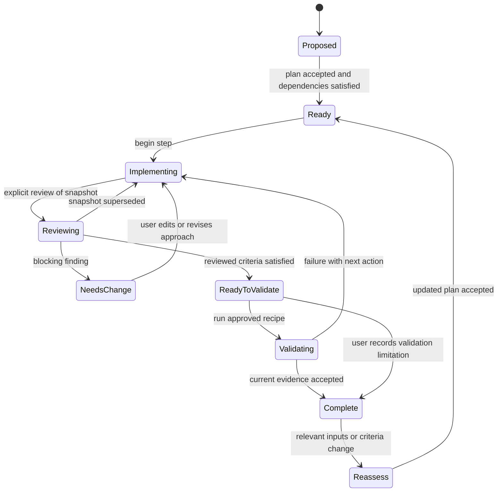

# UX and interaction specification

Status: proposed. [Plan entry point](README.md). These are low-fidelity interaction sketches, not validated screens.

## Working layout

Keep the editor central and the current task visible. The task panel is resizable/collapsible; chat is a tab within it. A bottom panel holds problems, checks, terminal and changes. Never steal focus from typing when an AI message arrives.

```text
Tandem / project                 Companion · AI cannot edit     ChatGPT: connected
┌─────────────────┬────────────────────────────────┬────────────────────────────┐
│ Files / Search  │ search.rs    tests.rs •        │ Task: Add bounded search   │
│ src/            │                                │ Step 2 of 4 · Implement    │
│ tests/          │          CODE EDITOR           │                            │
│                 │                                │ What / Why / Done when     │
│ Quick open…     │                                │ Files and dependencies     │
│                 │                                │                            │
│                 │                                │ Guidance: high-level       │
│                 │                                │ Explain: detailed          │
│                 │                                │ Solution: hidden           │
│                 │                                │ [Hint] [Explain] [Reveal]  │
│                 │                                │ [Review this step]         │
├─────────────────┴────────────────────────────────┤ [Plan] [Questions]         │
│ Problems | Checks | Terminal | Changes            │ [Delegate…]                │
│ No check has run on the current buffer version.  │                            │
└──────────────────────────────────────────────────┴────────────────────────────┘
Rust · rust-analyzer ready       Unsaved: 1          Last durable recovery: now
```

Status communicates active mode and authority in words, not color alone. A disconnected AI badge does not imply editor failure. The overall goal and current step remain visible even while viewing a finding or asking a question.

## 1. Open a project and set assistance

```text
Welcome to Tandem                 [Open folder]  [Recent projects]
     ↓ open
Project: sample                  Editor available immediately
Tools: Rust detected · language tools not enabled yet
[Enable project tools]  [Inspect tool commands]

Assistance                         Applies to: [Project ▾] [Rust ▾]
Instructions  [Inherit: standard ▾]  source: Global
Explanations  [Detailed ▾]           source: Project → Rust
Solutions     [Hidden ▾]             source: Global
[Use suggested Rust preset]         Shows exact fields before selection

AI connection: Not connected        [Sign in with ChatGPT] [Later]
```

Keep onboarding inline and dismissible. File access is user-selected; executable-tool trust explains that language servers/build scripts may run code. Do not conflate tool trust, subscription sign-in, assistance preferences and takeover permissions. Missing tools have actionable status; syntax highlighting and editing still work.

### Settings model and precedence

Resolve each field independently, lowest to highest:

1. Global defaults.
2. Global preference for the relevant language.
3. Project defaults.
4. Project-language override.
5. Temporary current-step override, optionally targeted to one language.

Unspecified fields inherit. **Reset to inherited** removes the local override; it does not copy the current inherited value into a permanent setting. Temporary step changes expire on completion/abandonment, remain visible when resuming that same step, and never silently become a project preference. Persisted project preferences are local user settings initially; repository files cannot grant execution authority.

| Control | Values | Meaning |
| --- | --- | --- |
| Instructions | High-level / standard / detailed | How much implementation structure a step describes |
| Explanation depth | Concise / standard / detailed | Rationale and concept explanation, independent of solution visibility |
| Solution policy | Hidden / on request / automatic preview | Hidden keeps answer content out until an explicit reveal; on request makes the preview affordance more prominent; automatic preview is an explicit standing request to show it |
| Hint | One additional hint | One-off response; does not change persistent settings or reveal a full implementation |
| Explain | Task / concept / selected section | Direct answer at selected depth; a section may be the user's existing code or an already revealed example |
| Ask | Free text | Follow-up within the task; no mandatory quiz |
| Help for this step | Temporary field overrides | Changes current assistance only, never permissions |

Hidden and on-request share the same content boundary; the difference is presentation, not a weaker security mode. A direct “show me the function” request is a reveal request for that function. “Explain borrowing” is not. Showing/copying an example never edits a file.

Mixed-language example: global explanations = concise; global Rust = detailed; project explanations = standard; project Rust = detailed; temporary step Python = detailed. The Rust file resolves to detailed from project-Rust, Python to detailed from this step, and a JavaScript file to standard from the project. Show provenance per field in a small inspector. Resolution follows the language of the guided symbol, not whichever tab happens to have focus.

A multi-language step displays separate language badges and separate previews. Revealing a Rust example cannot reveal a hidden Python example. Prefer splitting a step by responsibility when the two languages describe separate work. A settings change while generation is active invalidates its display policy; finish into a quarantined result or cancel, never reveal under obsolete settings.

## 2. Start a feature and review its decomposition

```text
New task: "Add bounded search to this collection"
     ↓ Analyze [Cancel]    Included: search.rs, callers, tests, Cargo.toml
Outcome: return matching positions within the requested bounds
Existing design: sorted storage; callers rely on stable duplicate ordering
Unknown: are unsorted inputs possible?  Assumption: reject them at boundary
Acceptance: empty/range/duplicate cases; existing caller behavior preserved

Proposed plan                           [Edit criteria] [Ask] [Revise approach]
1. Define bounds and invalid-input contract
2. Implement lookup       depends on 1
3. Add edge-case tests    depends on 1–2
4. Integrate caller and validate
                         [Start with this plan]
```

For small tasks this can be one concise step. Analysis always addresses purpose, context, constraints, unknowns and success; it need not always ask a question. The user can revise assumptions or combine/split/reorder valid steps. Accepting a plan starts guidance, not takeover. Routine refinements update the plan visibly; changes to objective, acceptance or execution scope require a deliberate decision.

## 3. Implement with the solution hidden

```text
Step 2 · Implement lookup                    Solution hidden
What: implement the bounds-aware lookup in src/search.rs
Why: callers need to limit work to an allowed region
Depends on: bounds contract from step 1
Done when: edge cases match the agreed contract; tests exercise boundaries

[Hint] [Explain the algorithm] [Reveal suggested solution] [Ask]
                         ↓ user writes code freely
[Review this step]       Captures current unsaved buffers; does not save them
```

No pre-generated solution is stored in the ordinary task payload. Explanation requests use a guidance-only result shape. Do not stream unvalidated model text directly into the panel: a model might include an unrequested implementation. Reject/quarantine unexpected solution fields or full implementation blocks. Semantic hints can still disclose more than intended; use regression fixtures and honest limits rather than claim a perfect “answer leakage” classifier. Existing user code can appear in a review explanation without authorizing a new generated solution.

## 4. Reveal a full solution and explain sections

```text
Step 2 · One possible implementation         Companion · AI cannot edit
┌─────────────────────────────────────────────────────────────────┐
│ Suggested solution preview [read-only]                          │
│  [A] Guard the bounds                                           │
│  [B] Search the allowed range                                   │
│  [C] Convert the result to the caller's coordinate space         │
├─────────────────────────────────────────────────────────────────┤
│ Explain: [A] [B] [C]     Depth: detailed                         │
│ Why borrow the slice? ...                                       │
│ Alternatives and assumptions: ...                               │
└─────────────────────────────────────────────────────────────────┘
[Copy selected text] [Collapse preview] [Ask] [Back to my code]
```

There is no automatic insert/apply button in this view. Copy writes to the clipboard only; the user decides whether to paste. The example is neither an answer key nor a requirement to use that algorithm. Clearly label its assumptions and whether it has been checked. If the plan changes, label the old example outdated.

## 5. Submit a different valid implementation

```text
Review this step → Reviewing snapshot 42 (includes unsaved search.rs)
    ├─ relevant compiler/LSP/check evidence
    └─ acceptance and integration review

Result: Your implementation meets the reviewed criteria.
Approach differs from the preview: iterator-based bounds handling.
Evidence: empty and duplicate cases passed; caller contract preserved.
Remaining validation: release build has not run.
[Run release check] [Complete with noted limitation] [Ask]
```

Review evidence is stronger than model preference. A possible alternative is not penalized for naming, structure or textual differences. Do not falsely claim a test ran. The completion action records the current evidence and any explicit limitation.

## 6. Resolve a review finding

```text
Finding 1 of 2 · Demonstrated correctness problem · Blocks completion
src/search.rs: empty input reaches element zero
Why it matters: this panics instead of returning no match
Evidence: test_empty failed on snapshot 42 → [Open output]
Smallest next action: handle the empty case before indexing
[Go to code] [Explain] [Ask]                 No automatic patch

After editing: Applies to earlier version · [Review updated step]
Optional finding: rename an ambiguous variable · Style preference
```

Finding classes: demonstrated correctness, likely concern needing verification, design tradeoff, style preference. Severity and blocking status are separate. Style and optional tradeoffs do not block completion by default. A likely concern offers a concrete way to verify it; no confident red error solely because the model is unsure. Users can dispute a finding and attach evidence, dismiss an optional suggestion or revise criteria. These are decisions on a task, not a skill record.

On explicit review, capture the input snapshot first. Show “Reviewing version X”; if a relevant buffer changes, mark the run superseded. It may finish for reference but cannot place current red squiggles, pass the new step or invalidate the new implementation. A **Review updated step** action is one click; never repeatedly restart while typing.

## 7. Review clarity, speed or both

```text
Selected: lookup()             Improve: [Clarity] [Speed] [Balanced]
Scope: this symbol + callers/tests              [Analyze]

Proposal: binary search for repeated lookups
Requires: sorted random-access input and agreed duplicate semantics
Expected: fewer comparisons for large inputs; not measured
Costs: more complex bounds logic; sorting once may dominate one lookup
Evidence needed: representative sizes, duplicate cases and lookup frequency
[See proposal] [Plan benchmark] [Keep current approach] [Ask]
```

Clarity checks prioritize understandable control flow, naming and contracts. Speed checks investigate actual workload/preconditions, including allocation, memory and surrounding calls. Balanced presents the smallest change that plausibly matters. Show expected algorithmic complexity separately from observed timings. Benchmarks include toolchain/build mode, inputs, sample method and variance; preserve behavior using correctness tests. A performance proposal stays optional unless it demonstrates failure of an accepted performance requirement.

## 8. Delegate and take control back

```text
Delegate: [Current step ▾]      Goal: implement the agreed lookup contract
Allowed source paths: src/search.rs, tests/search.rs
Checks: search-tests recipe    Network: off
Includes: current unsaved buffers and existing work
Output: isolated changes for review; live workspace remains yours
[Start takeover]
     ↓
Agent takeover · Step 2 · isolated copy        [Stop and take control]
Activity: edited search.rs → ran search-tests → repairing failed case
Live diff | Checks | Scope
     ↓ complete or stopped
Handoff: 2 files changed; 6 tests passed; no process remains active
[Inspect diff] [Import changes] [Keep staged] [Discard isolated changes]
     ↓ import
Companion · AI cannot edit     Imported changes are an undoable buffer group
```

During takeover, edits made by the user remain in the live editor. At import show any divergence and retain conflicting versions. Never auto-merge overlapping edits or discard unrelated work. The **Undo agent import** action names the transaction, previews a conflict if needed, and leaves later user changes intact. Cancel stops future work but does not pretend completed commands never ran. If process termination is uncertain, say “Stopping / checking process state.” No unprompted permission ceremony inside already granted scope.

## 9. Resume after restart or AI failure

```text
Project restored · Task: bounded search · Step 2
Recovered unsaved buffer: search.rs      [Compare with disk] [Keep recovered]
Previous review: snapshot 42 · stale
Previous takeover: interrupted · isolated diff retained [Inspect]
AI: connection unavailable               [Reconnect] [Continue editing]
```

Reconnect reconciles remote turn status before offering retry. It never restarts takeover or a possibly completed command automatically. Usage exhaustion shows supplied reset information; no speculative countdown or billing fallback. Missing credentials open managed sign-in without closing the project. A corrupt snapshot, changed project path or missing runtime has its own repair action and does not erase recovered work.

## Step lifecycle and failure states



Blocked, paused, canceled and connection-unavailable are separate operation/task flags rather than a growing collection of hidden conversational meanings. Taking over is an authority state attached to the current step/task, not an assistance setting.

| Situation | UI response |
| --- | --- |
| No project/task | Clear open/start actions; editing does not require a task |
| Analysis/review loading | Progress by activity, cancel available, no invented percent complete |
| No findings | State what was inspected and what was not verified |
| Incomplete code | Diagnostics may show, but no unsolicited model judgment that the step failed |
| Invalid AI result | Result failed to load; preserve prior valid plan and offer retry |
| Check failed | Exit/diagnostic evidence, next useful action; distinguish infrastructure failure from failing test |
| Save failed | Buffer stays dirty; show cause/retry/alternate save location |
| Scope exceeded | Pause agent action, explain requested expansion; previously completed work remains inspectable |
| Recovery incomplete | Preserve files and explain exactly which state is unavailable |

## Keyboard and accessibility

Provide a command palette for every routine action. Proposed defaults: Cmd-P quick open, Cmd-Shift-P commands, Cmd-F file find, Cmd-Shift-F project search, Cmd-S save, Cmd-Z/Shift-Cmd-Z undo/redo, Cmd-Shift-Enter review current step when the editor has focus. Reveal, explain, delegate and stop are palette actions with user-remappable shortcuts; avoid easy accidental takeover. Confirm bindings against macOS/IME behavior in M0-B and M5.

Use explicit focus order, keyboard navigation between code/task/results, readable status names, non-color distinctions, scalable text and restrained announcements. Announce review completion without reading every streamed token. Dialogs are for exceptional destructive/conflicting operations; routine guidance and permission scope are inline panels. Verify with VoiceOver and real input methods, not only component metadata tests.
